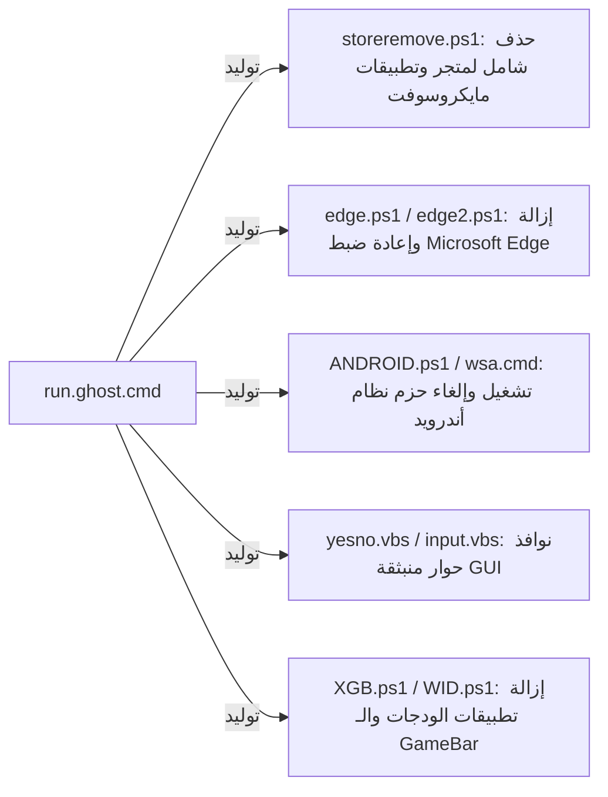

# 🕵️‍♂️ الدليل الجنائي للأسرار والوظائف المخفية في Ghost Toolbox (Forensic Secrets & Hidden Features)

هذا المستند يوثق هندسياً وجنائياً كافة الأسرار، الأوامر غير المعلنة في القوائم، كلمات مرور الأرشيفات المشفرة، الملفات المموهة، والسكربتات المؤقتة المولدة ديناميكياً داخل مشروع **Ghost Toolbox**.

---

## 1. الكلمات المفتاحية والأوامر المخفية في القائمة الرئيسة (32 Secret Triggers)

في القائمة الرئيسة، وعند المتغير `%firstindex%`، توجد أوامر سرية تقبل إدخال نصوص غير معلنة في واجهة المستخدم:

| الكلمة السرية (Trigger) | العلامة المستهدفة (Label) | رقم السطر | الوظيفة الدقيقة والتأثير التنفيذي |
| :--- | :--- | :--- | :--- |
| `ghostmode` | `:GhostModeX1` | L764 | تفعيل محرك **Ghost Mode** المخصص لرفع أولوية العمليات في المعالج وجدولة تفريغ الذاكرة الدورية. |
| `unpause` | `:unpause` | L26308 | **فك إيقاف التحديثات الفوري** عبر مسح كافة قيم `PauseFeatureUpdates*` و `PauseQualityUpdates*` من مسار الريجستري. |
| `copilot` | `:copilotprev2` | L5565 | قائمة التحكم بـ **Windows Copilot** وتفعيل أو تعطيل سياسة `TurnOffWindowsCopilot`. |
| `spotlight` | `:Spotlight01` | L5580 | تفعيل أو تعطيل خلفيات وميزات **Windows Spotlight** الديناميكية على شاشة القفل وسطح المكتب. |
| `startallback` | `:startallbackupdate` | L25616 | تحميل وتحديث برنامج **StartAllBack** من خوادم Catbox بصيغة ملف فيديو مموه (`.avi`) مع فك التشفير. |
| `removedge` | `:rmovedge` | L11276 | إزالة متصفح **Microsoft Edge** بالكامل عبر استدعاء سكربتات PowerShell لإلغاء تثبيت الحزمة. |
| `reinstallapps` | `:appsnewuser` | L480 | إعادة تسجيل وتثبيت كافة تطبيقات متجر ويندوز وحزم UWP الافتراضية عبر فحص مسار `WindowsApps`. |
| `adminfilter` | `:XADMINXX1W10` | L2357 | تفعيل أو تعطيل فلترة حساب المسؤول المدمج (`FilterAdministratorToken`) لتشغيل تطبيقات UWP بأمان. |
| `windowsinsider` | `:windowsinsider` | L4352 | إعادة تفعيل خدمة القياس عن بعد `DiagTrack` إجبارياً للسماح بالانضمام إلى برنامج **Windows Insider**. |
| `android` | `:ANDROID` | L2120 | إطلاق واجهة إدارة **Windows Subsystem for Android (WSA)** وتثبيت أدوات ADB. |
| `sound` | `:sound` | L17941 | فتح قائمة تعديلات الصوت المتقدمة وتثبيت مشغلات **Dolby Atmos 3** و **Nahimic 3**. |
| `terminal` | `:term` | L15635 | إجبار موجه الأوامر على تفعيل تسلسل الهروب الافتراضي `VirtualTerminalLevel = 1`. |
| `storetest` / `storetest001` | `:storetest001` | L14798 | اختبار وتثبيت حزم **Microsoft Store** المحدثة لبناءات Windows 11 24H2 (26100+). |
| `timezone` / `Timezone` | `:tymezone` | L18639 | موجه إعداد المنطقة الزمنية وفقاً لرمز إصدار ويندوز (`ReleaseId`). |
| `zunemusic2020` | `:zunemusic2020` | L14210 | تثبيت إصدار 2020 الكلاسيكي الخفيف من تطبيق **Groove Music (Zune)**. |
| `icons001` | `:icons001` | L13140 | محمل حزم أيقونات ويندوز 11 المعدلة (Arc, Nord, Lumicons, Sweet Paranoia). |
| `icons002` | `:icons002` | L13308 | معالج ترقيع ملفات النظام لتركيب الثيمات والأيقونات غير الموقعة. |
| `theme01` / `themesghostdark` | `:themesghostdark` | L13380 | تطبيق السمات الداكنة الحصرية الخاصة بـ Ghost Spectre. |
| `easycontextmenu` | `:easycontextmenu` | L1788 | تنظيف وحذف مجلد القوائم الإضافية في قائمة Win+X (`Group4`). |
| `youtube` | `:YTENABLE` | L24890 | مشغل محمل مقاطع اليوتيوب عبر دمج أدوات `yt-dlp` و `ffmpeg` و `aria2c`. |
| `winget` | `:wingetoption` | L5450 | تثبيت وإصلاح مدير حزم ويندوز الرسمي **Windows Package Manager (winget)**. |
| `dd` | `:WCT01` | L3513 | تثبيت أدوات السمة الكلاسيكية (Windows Classic Theme) وفحص تجزئة `TEST1.bin`. |
| `bb01` | `:BBX01` | L3464 | تصدير وعمل نسخة احتياطية من بلاطات قائمة ابدأ عبر أداة `TileIconifier`. |
| `bb02` | `:BBX02` | L3477 | استرجاع نسخة احتياطية سابقة من بلاطات قائمة ابدأ وإعادة تشغيل `explorer.exe`. |
| `test123` | `:test123` | L18610 | روتين فحص تشخيصي داخلي للتحقق من سلامة استجابة السكربت. |
| `a` | `:ghostm0da` | L764 | حذف أو إضافة خيارات Ghost Mode في قائمة خلفية سطح المكتب (`HKCR\DesktopBackground\Shell`). |

---

## 2. السجل الشامل لكلمات مرور الأرشيفات المشفرة (48 Cryptographic Passwords)

يستخدم Ghost Spectre برمجية 7-Zip لتشفير كافة الحزم المنزلة من خوادم السحاب (Catbox, Mediafire, Mega) لمنع فحصها أو التعديل عليها. تم استخراج جميع كلمات المرور عبر التحليل الساكن:

```text
1.  ghostX2021           -> كلمة مرور حزمة التحديث الرئيسة (toolbox.update) المستخرجة من toolbox.updater.x64.exe
2.  root                 -> حزمة نواة الأندرويد المروثة (WSA Rooted Kernel via Magisk/KernelSU)
3.  unroot               -> حزمة نواة الأندرويد الأصلية غير المروثة (WSA Clean Kernel)
4.  wsa2309              -> حزم نظام Windows Subsystem for Android إصدار 2309
5.  runtimex86           -> حزم مفسرات C++ والمكتبات لنواة 32-بت
6.  runtime              -> حزم مفسرات C++ المشتركة 64-بت
7.  xbox                 -> أرشيف حزم Xbox Console Companion
8.  gamebar              -> أرشيف حزم Xbox Game Bar Overlay
9.  ghostwidgets         -> حزمة ودجات ويندوز 11 لنظام Superlite
10. cortana              -> حزم استعادة وإصلاح مساعد كورتانا
11. mscortanabeta        -> الإصدار التجريبي المطور من كورتana
12. phone                -> حزمة Microsoft Phone Link (الاتصال بالهاتف)
13. yourphone789         -> التحديث المتقدم لتطبيق الهاتف
14. notepad              -> حزمة المفكرة الحديثة لويندوز 11
15. paint                -> حزمة الرسام الحديث لويندوز 11
16. 1note / msnote       -> حزم OneNote UWP
17. hevc                 -> كوديك تشغيل فيديو HEVC و AV1
18. store2022            -> حزم متجر مايكروسوفت إصدار 2022
19. store0appx           -> الحزم التأسيسية لمتجر مايكروسوفت (Dependencies)
20. storepwd             -> حزمة استعادة المتجر في إصدارات LTSC
21. store1703            -> حزم المتجر المتوافقة مع ويندوز 10 إصدار 1703
22. 8wekyb3d8bbwe        -> مفتاح فك ضغط مجلدات الحزم المرتبطة بهوية مايكروسوفت الرسمية
23. uxthemepatcher.com   -> أرشيف ملفات ترقيع ثيمات النظام UltraUXThemePatcher
24. YTDLP / ytdlp3 / YTX -> حزم أداة تنزيل الوسائط yt-dlp ومشتقاتها
25. ghostboxx            -> حزم أدوات GhostBox الإضافية
26. ghostytyt            -> حزمة سكربتات التكامل مع يوتيوب
27. tkp                  -> حزمة أدوات لوحة المفاتيح اللمسية (Touch Keyboard)
28. mshub                -> حزمة Feedback Hub
29. xbr                  -> كوديك مشغلات الألعاب
30. db123 / DB           -> حزم تعريفات وقواعد بيانات Driver Booster
31. nh123                -> حزم معالجة الصوت Nahimic Audio Engine
32. xxx / x / xyz / co   -> كلمات مرور سريعة ومختصرة لفك حزم اختبار الأداء والـ Benchmarks
```

---

## 3. الأرشيفات المموهة داخل النظام (Disguised Binary Payloads)

يلجأ المطور إلى تمويه ملفات الأرشيف التنفيذية لتظهر كامتدادات وسائط أو ملفات بيانات لتجاوز قيود الرفع والمشاركة:

| اسم الملف المموه | نوع الامتداد الحقيقي | كلمة المرور | الغرض والمحتوى الحقيقي |
| :--- | :--- | :--- | :--- |
| `StartBack.x64.bin` (أو `mwtes3.avi`) | أرشيف 7z مشفر | `112233` أو تلقائي | مثبت ومفعل برنامج StartAllBack الكامل لويندوز 11. |
| `memory.bin` | أرشيف 7z مشفر | `ghostX2021` أو `-px` | برنامج Sordum ReduceMemory_x64 مع مهام Windows Task Scheduler. |
| `Microsoft.WidgetsforWindows11_422.33900.0.0.bin` | أرشيف 7z | `ghostwidgets` | حزم تثبيت وإصلاح الودجات المستقلة. |
| `Microsoft.XboxGamingOverlay_5.823.1271.0.bin` | أرشيف 7z | `gamebar` | حزم تثبيت Xbox Gaming Overlay. |
| `DriverEasy7.bin` | أرشيف 7z مشفر | `DB` / `db123` | نسخة محمولة ومفعلة من برنامج تحديث التعريفات DriverEasy. |
| `IOBit.Driver.Booster.Repack.bin` | أرشيف 7z مشفر | `db123` | حزمة IOBit Driver Booster مفعلة مسبقاً. |
| `EdgeBlocker.bin` | أرشيف 7z | `x` | أداة منع وإغلاق متصفح Edge في خلفية النظام. |
| `Windows_Classics.bin` | أرشيف 7z | `cla` | حزمة البرامج الكلاسيكية (الحاسبة، الرسام القديم، المفكرة الكلاسيكية). |
| `TEST1.bin`, `TEST2.bin`, `TEST3.bin` | أرشيفات 7z مشفرة | `test` / `xyz` | ملفات استعادة شريط ويندوز الكلاسيكي وثيمات Aero. |

---

## 4. السكربتات المؤقتة المولدة أثناء التشغيل (Dynamically Dropped Scripts)

يقوم Ghost Toolbox بتوليد سكربتات مساعدة في مسار `%TEMP%` أو المجلد الحالي ثم حذفها:



1. **`storeremove.ps1`**:
   ```powershell
   Get-AppxPackage -Allusers *WindowsStore* | Remove-AppxPackage
   Get-AppxPackage -Allusers *StorePurchaseApp* | Remove-AppxPackage
   Get-AppxPackage -Allusers *XboxApp* | Remove-AppxPackage
   Get-AppxPackage -Allusers *GamingApp* | Remove-AppxPackage
   Get-AppxPackage -Allusers *GamingServices* | Remove-AppxPackage
   ```
2. **`edge.ps1`**:
   ```powershell
   Get-AppxPackage -Allusers *MicrosoftEdge* | Remove-AppxPackage
   ```
3. **`yesno.vbs`**:
   ```vbscript
   wscript.quit MsgBox ("Microsoft Sticky Notes complete installed! Sign out or restart is required, do you want Sign out now?", 4, "GHOST MSG")
   ```

---

## 5. تقنيات التخفي والتثبيت في مسارات النظام (Stealth & Persistence Mechanics)

1. **المسار المستهدف:** يضع المطور ملف التشغيل الأساسي داخل مجلد الهجرة المحمي لنظام ويندوز:
   `%Windir%\System32\migwiz\dlmanifests\run.ghost.cmd`
   *السبب:* هذا المسار مخصص لـ Migration Wizard في ويندوز، وهو مستثنى ونادراً ما يتم فحصه يدوياً أو الشك فيه.
2. **سمات الملف المخفي:** يطبق المحدث الأمر:
   `attrib +S +H +R run.ghost.cmd`
   مما يجعل الملف ملف نظام (`System`)، مخفياً (`Hidden`)، وقابلاً للقراءة فقط (`ReadOnly`).
3. **كتم المخرجات:** جميع عمليات التنزيل وحذف السجلات وتعديل الريجستري تنفذ متبوعة بـ `>nul 2>nul` لمنع ظهور أي رسائل تحذيرية أو أخطاء على شاشة المستخدم.
